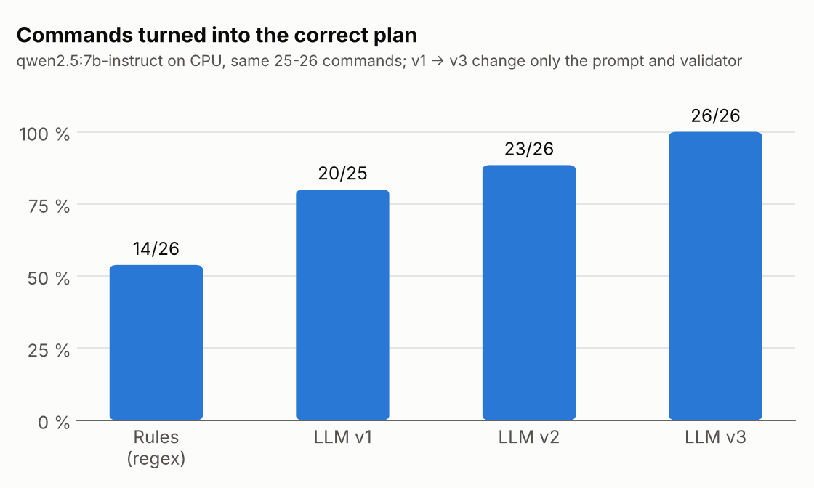
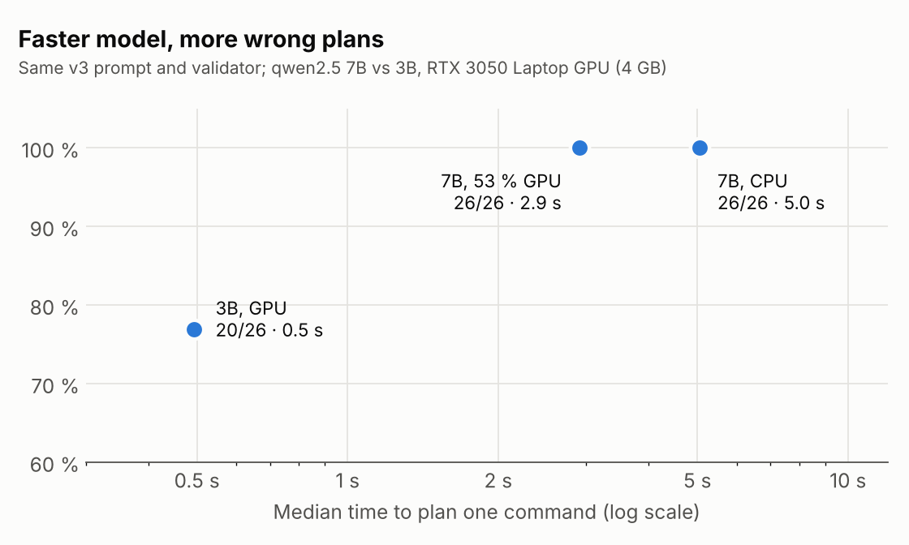

# Results: natural-language commands for a ROS 2 robot

Vidya Sagar, IIT Hyderabad, M.Tech RIS. All numbers below were measured on this workspace.
`python3 src/nlp_robot/tools/summarize_results.py` regenerates the table and figures from
`results/*.csv`.

## 1. Setup

| | |
|---|---|
| Robot / simulator | TurtleBot3 waffle in Gazebo Harmonic, ROS 2 Jazzy, Nav2 (AMCL + NavFn + DWB) on a map generated from the same spec as the world |
| Language layer | LLM → JSON plan restricted to 8 actions → validator → Nav2 actions (`plan_schema.py`, `command_parser.py`) |
| Models | `qwen2.5:7b-instruct` and `qwen2.5:3b-instruct` via Ollama (Q4 quantised); a regex parser as the baseline |
| Hardware | Intel Alder Lake laptop, 16 GB RAM, RTX 3050 Laptop GPU (4 GB) |
| Test set | 26 commands (`tools/eval_parser.py`): 21 the robot can carry out (paraphrases, number words, signed turns and moves, multi-step, coordinates, pronouns) and 5 it must refuse (impossible, unknown object or place, beyond the limits) |
| Grading | A plan is correct if its actions and targets match the expected plan, with numbers having the same sign and within 10 %. `find X` followed by `navigate_to X` counts as `navigate_to X`, since the robot does the same thing. A refusal is correct only if the plan is empty. |

## 2. Language layer: from regex to a validated LLM

| Run | Runs on | Accuracy | Plans carried out | Correct refusals | Repairs | Median latency |
|---|---|---|---|---|---|---|
| rules (regex baseline) | - | 14/26 (54 %) | 9/21 | 5/5 | 0 | 0.00 s |
| qwen2.5:7b-instruct v1 | CPU | 20/25 (80 %) | 16/20 | 4/5 | 2 | 15.34 s |
| qwen2.5:7b-instruct v2 | CPU | 23/26 (88 %) | 19/21 | 4/5 | 2 | 5.73 s |
| qwen2.5:7b-instruct v3 | CPU | **26/26 (100 %)** | **21/21** | **5/5** | 1 | 5.05 s |



v1 was measured on the first build of the project, with 25 commands (the pronoun case
"find the green box and go to it" was added later). Its latency was measured without
control over background load and before the model was kept loaded, so only its accuracy
is compared directly.

**What the regex baseline cannot do** is exactly what the LLM adds: paraphrases ("drive
over to the kitchen"), number words ("one metre", "half a meter"), and compositional
requests ("check whether there is a blue box in the reading nook" → go to the nook, then
search). The baseline refuses well only because it understands so little.

**v1 → v2.** The v1 failures were all fixed by targeted changes:

| v1 failure | Cause | v2 change |
|---|---|---|
| "turn right by 45 degrees" → +45°, which turns **left** | sign convention | a validator check compares the sign with the direction words in the command, then asks for a repair; a sign rule and example in the prompt |
| "take a look in the nook" → also `find red_box` | made up a goal nobody asked for | prompt rule: only search for objects the user names |
| "return to the kitchen" → `return_to_start` + `navigate_to` | "return" taken literally | prompt rule |
| "fly to the ceiling" → a spin | substituted an action instead of refusing | prompt rule: refuse, never substitute |

**v2 → v3.**

| v2 failure | Cause | v3 change |
|---|---|---|
| "drive 50 metres forward" → `move 2.0` | **the repair message gave the limit, so the model shortened the move to fit it** | the error message now says "do not shorten, refuse"; a validator check compares the distances in the command with the limit |
| "return to the kitchen" still added `return_to_start` | the prompt rule alone was not enough | a validator check |
| "find the blue box" also drove up to it | did more than it was asked | prompt rule and example |

**Finding 1: the wording of the error message matters as much as the prompt.** The
repair round is a second prompt. An error that only states a limit invites the model to
fit inside it, which turns an unsafe request into a different, unrequested action.

**Finding 2: checks in code beat prompt rules for anything that can be checked.** Each
v2 → v3 fix that moved from the prompt into the validator became a guarantee rather than
a suggestion. The v2 prompt rule for "return to <place>" still failed; the v3 validator
check catches it every time.

## 3. Model size and hardware

| Model (v3 prompt) | Runs on | Accuracy | Correct refusals | Median latency |
|---|---|---|---|---|
| qwen2.5:7b-instruct | CPU | 26/26 | 5/5 | 5.05 s |
| qwen2.5:7b-instruct | 53 % GPU / 47 % CPU | 26/26 | 5/5 | **2.91 s** |
| qwen2.5:3b-instruct | 100 % GPU | 20/26 | 3/5 | **0.49 s** |



The 7B model (5.2 GB) does not fit in 4 GB of GPU memory, so Ollama splits it: putting
half the model on the GPU gives a 1.7× speed-up with no change in accuracy. The 3B model
fits entirely on the GPU and is 6× faster again, but loses 6 commands:

| Command | 3B plan | Kind of error |
|---|---|---|
| bring me a coffee | `navigate_to kitchen` ("to get a coffee") | substitutes a possible action for an impossible one |
| go to the purple box | `navigate_to home` ("let's go home instead") | substitutes instead of asking |
| go to coordinates x 1.5, y -0.5 | `move 1.5; move -0.5` | wrong action for the meaning |
| turn around and go back 30 cm | `rotate -90; move -0.3` | the repair fixed one step and broke another |
| find the green box and go to it / visit … then the green box | `find green_box` only | drops "go to it" |

**Finding 3: validation guarantees a plan is safe and something the robot can do, not
that it means what was asked.** Every 3B plan above is valid (known targets, within the
limits), so no check can reject it. Whether the plan matches the user's intent comes from
the model's capability. The 7B is the default; the 3B is the option when speed matters
more than reliability.

The 3B run also exposed a UI bug: after a repair, the plan was `rotate -45` but the
model's reply still said "Turning left 45 degrees". Since then, the robot's reply is
always generated from the validated plan. The model's own wording is used only when
nothing moves (refusals and questions), and is kept in the CSV's `llm_reply` column.

## 4. The whole system in simulation

Commands typed in `nlp_cli`, with the 7B model and Gazebo, Nav2 and RViz running:

| Command | Plan | Outcome |
|---|---|---|
| go to the kitchen, then come back | `navigate_to kitchen`, `return_to_start` | succeeded, 58.8 s |
| go to the office, wait 2 seconds, then come back | 3 steps | succeeded, 37.8 s |
| do that again | same 3 steps, from the command history | succeeded, 36.6 s |
| turn around and back up 30 cm | `rotate +180`, `move -0.3` | succeeded, 6.4 s |
| turn right 90 degrees and move forward half a metre | `rotate -90`, `move +0.5` | succeeded, 5.6 s |
| go to the kitchen, **Ctrl+C** partway | `navigate_to kitchen` | **stopped after 10.3 s**: command and Nav2 goal cancelled, robot halted |
| bring me a coffee | empty | refused, nothing moved |
| go to red box then go to home | `navigate_to red_box`, `navigate_to home` | succeeded, 49.7 s |
| is there a blue box in the reading nook? | `navigate_to reading_nook`, `find blue_box` | found it, 29.4 s |

**Planning time is 5.6–12.7 s live, against 2.9 s in the offline evaluation.** Half the 7B
model runs on the CPU, and the simulator (physics, camera rendering, Nav2, the detector)
competes with it for that CPU. Hiding the Gazebo window (`gui:=false`) did not change
this, so the cost is the simulation itself, not its display. On a real robot with a
dedicated GPU, or with the 3B model, this drops below a second.

## 5. Perception: finding the boxes

Detection error, the distance between Gazebo's true box position and the detector's
estimate, measured with the `ground_truth` node:

| Box | Error | Notes |
|---|---|---|
| yellow | 0.03 m | |
| red | 0.08 m | |
| blue | 0.09 m | after being **moved by hand** next to the red box; the tracker picked up the new position |
| green | 0.24 m | in the storage bay, seen at an angle past the partition |

**Finding 4: the camera has to measure distance when the LiDAR can't reach.** The
TurtleBot3 LiDAR stops at 3.5 m, and every box is about 4.2 m from the start position. With
LiDAR-only distance, "go to the red box" from home toured every lookout and took **132 s**.
Estimating distance from the box's known height in the image cut it to **19 s**, found
during the first spin. Far boxes are approached in two stages, so the final stop uses the
precise LiDAR distance.

Searching has no prior about where a box might be. "find the green box", which is behind
the storage partition, took 118 s because the box can't be seen from home, the kitchen or
the nook. Once a box has been seen, later commands use the remembered position
("go to the green box": 9.2 s).

## 6. Safety design

1. **A closed set of actions.** 8 actions; the LLM cannot output velocities or code.
2. **Structured output.** The JSON schema is given to the model itself (Ollama `format`,
   Anthropic forced tool call, OpenAI `json_schema`).
3. **Validation before anything moves.** Known targets only, points inside the map,
   moves between −2 m and +3 m, turns within ±720°, ≤ 12 steps, turn and move signs consistent with the command, no
   silent shortening, "return to <place>" handled correctly.
4. **Bounded self-repair.** One repair round. If the second answer also fails, nothing moves.
5. **Clarify instead of guessing.** An empty plan plus a question is a valid answer.
6. **The robot's reply comes from the validated plan.** What the robot says is what it does.
7. **Always stoppable, one command at a time.** Ctrl+C cancels the command and the Nav2
   goal; a second command is rejected while one is running.
8. **Graceful degradation.** If the LLM is down or times out, the regex parser takes over.

## 7. Limitations

- **Small test set.** 26 hand-written commands in one room. 100 % here doesn't mean
  100 % on real users' phrasing.
- **Deterministic runs.** The model ran at temperature 0, one run per configuration;
  results may vary across model versions and quantisations.
- **Correct intent isn't guaranteed.** See finding 3. A larger model, or a second LLM
  pass that checks the plan against the command, would help.
- **Colour-only perception.** HSV thresholds on simulated, evenly lit cubes. Real lighting
  needs re-tuning or a learned detector.
- **Search has no prior.** Nearest lookout first, with no idea where objects tend to be.
- **Simulation only.** The language and perception layers need only `/scan`, a camera and
  Nav2 (`nlp_stack.launch.py use_sim_time:=false`), but this has not been tested on
  hardware.

## 8. Future work

- Answer questions the robot already knows the answer to ("where is the blue box?",
  "is it near the red box?") with a `say` step from remembered positions, without moving.
- Speech in and out (Whisper → text, text-to-speech for replies).
- Open-vocabulary detection (e.g. a vision-language model) instead of colour thresholds,
  so the robot can be asked for objects it has never been configured for.
- A plan-checking pass: ask the LLM whether the validated plan does what the command
  asked, to catch the 3B's substitution errors.
- Semantic memory: remember where objects were last seen across sessions, and search
  there first.

## 9. Reproduce

```bash
cd ~/nlp_robot_ws/src/nlp_robot
python3 -m pytest test/ -q                                           # unit tests
python3 tools/eval_parser.py --backend rules
python3 tools/eval_parser.py --backend ollama --model qwen2.5:7b-instruct --label v3
python3 tools/eval_parser.py --backend ollama --model qwen2.5:3b-instruct --label v3-gpu
python3 tools/summarize_results.py                                   # table + figures

ros2 launch nlp_robot bringup.launch.py                              # whole system
ros2 run nlp_robot nlp_cli
```
